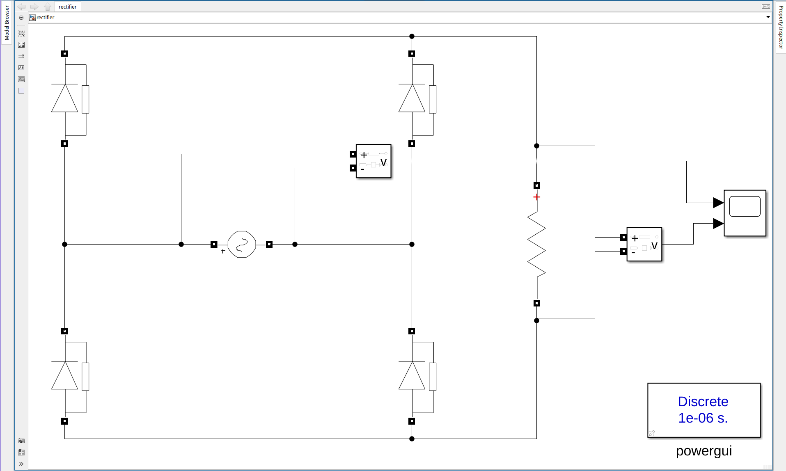
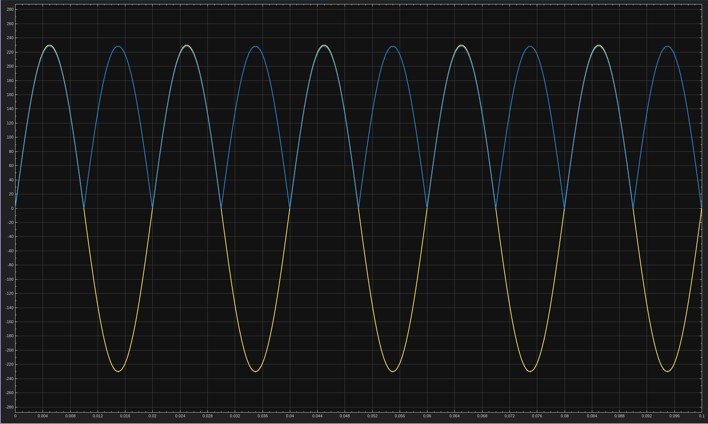

# 1. Full-Bridge Rectifier
Single-phase diode bridge feeding a resistive load, fed from a 230 V, 50 Hz AC source.

| File | Description |
|------|-------------|
| `rectifier.slx` | Simulink model |
| `1a.png` | Circuit |
| `1b.png` | Output waveforms |

