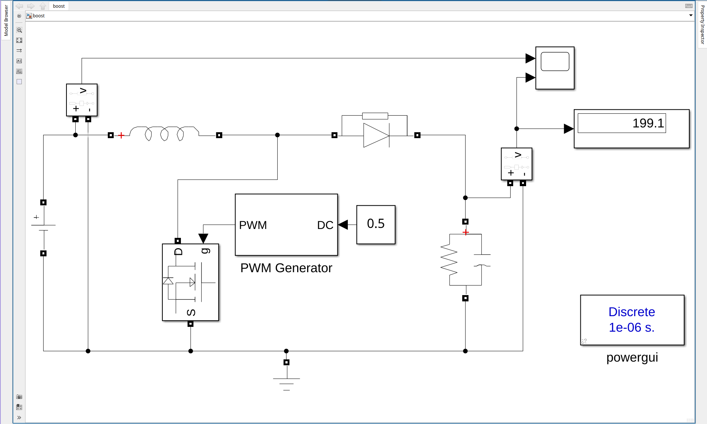
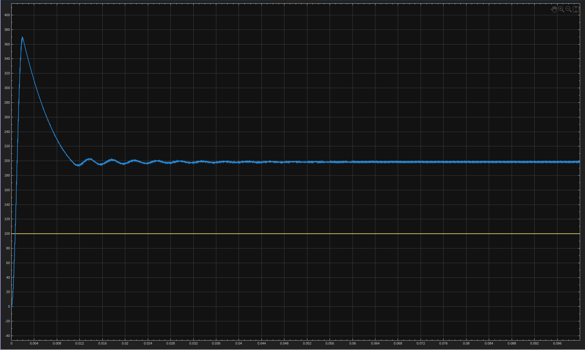

# 2. DC-DC Boost Converter
Open-loop boost: inductor, MOSFET, diode and RC load, with the PWM generator at a fixed duty cycle of 0.5. Output reads about 199 V.

| File | Description |
|------|-------------|
| `boost.slx` | Simulink model |
| `2a.png` | Circuit |
| `2b.png` | Output waveforms |

