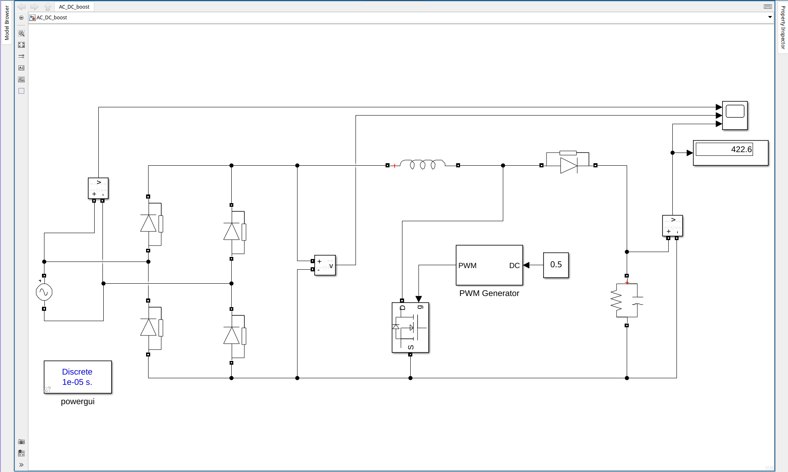
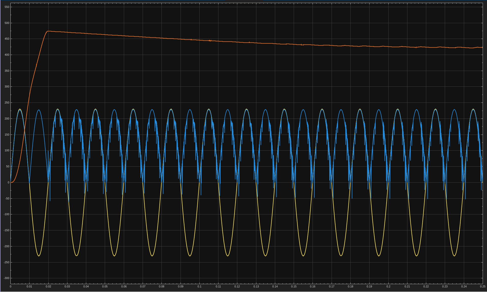

# 3. AC-DC Boost Converter (Open Loop)
Diode bridge from a 230 V, 50 Hz source followed by the boost stage at a fixed duty of 0.5. No feedback. Output reads about 423 V.

| File | Description |
|------|-------------|
| `AC_DC_boost.slx` | Simulink model |
| `3a.png` | Circuit |
| `3b.png` | Output waveforms |

