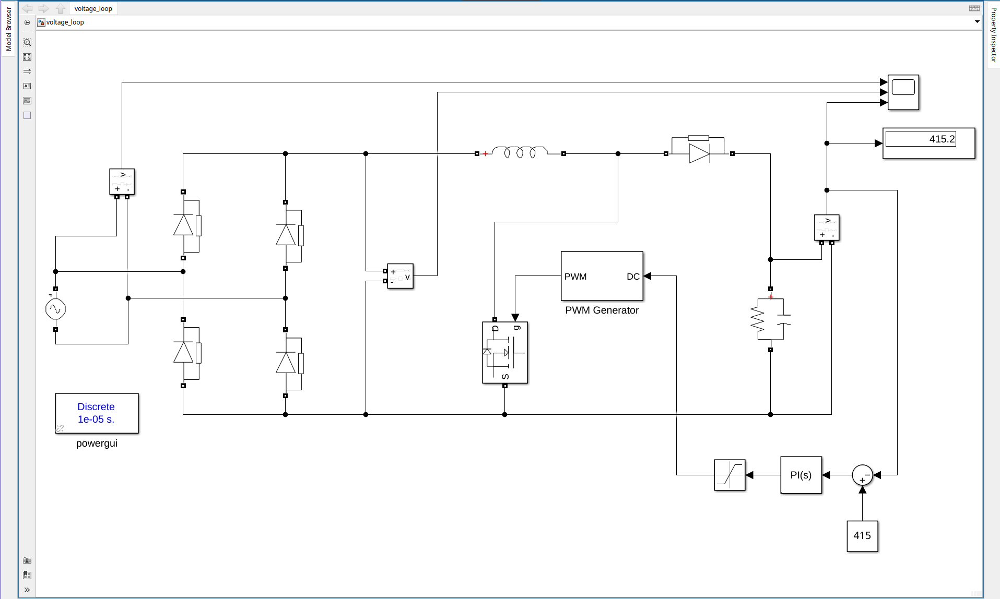
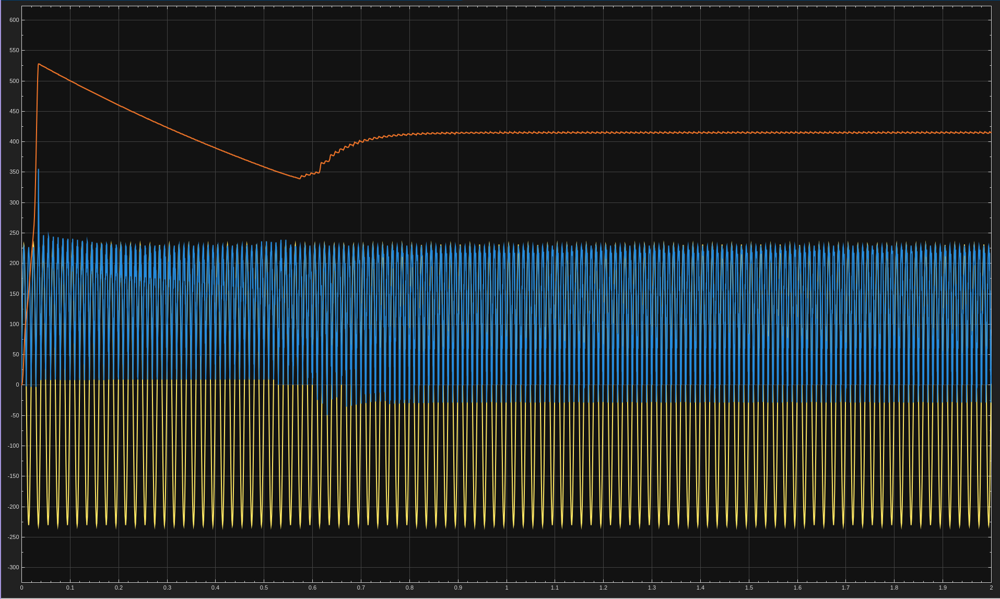

# 4. Outer Voltage Control Loop
Closes the loop on stage 3: output voltage is compared to a 415 V reference, and a PI controller with saturation sets the PWM duty. Output reads about 415 V.

| File | Description |
|------|-------------|
| `voltage_loop.slx` | Simulink model |
| `4a.png` | Circuit |
| `4b.png` | Output waveforms |

