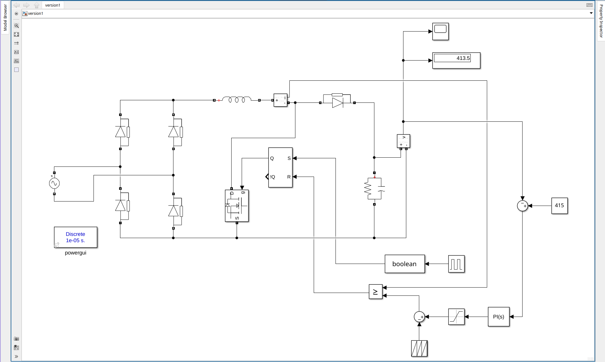
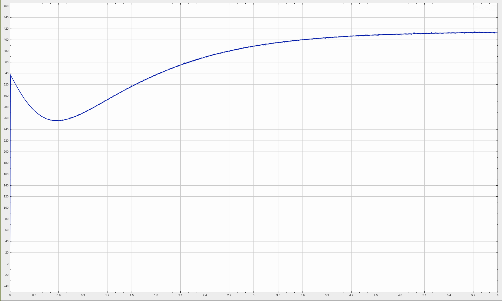
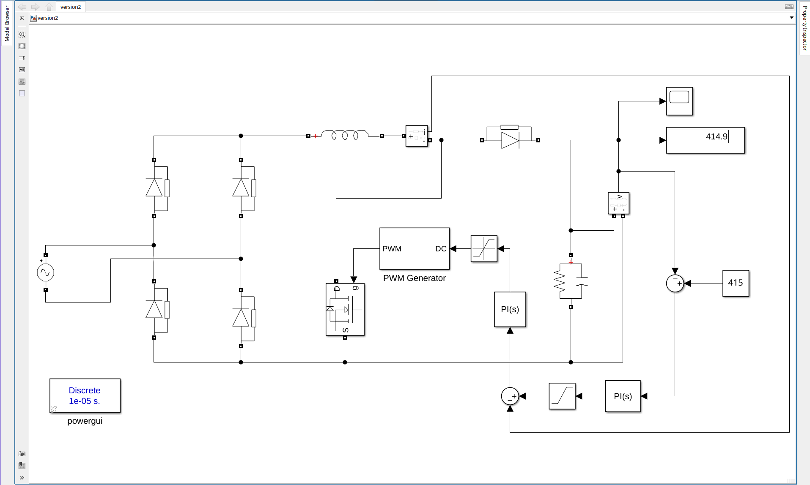
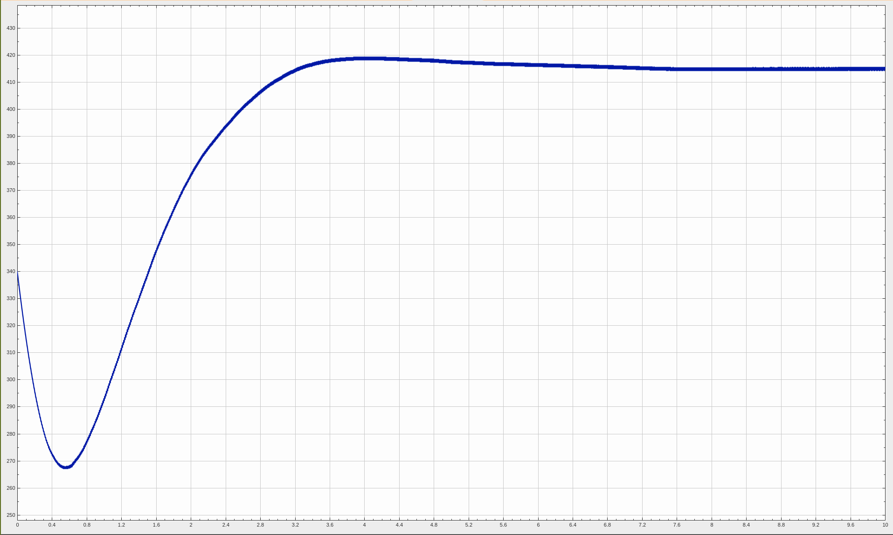
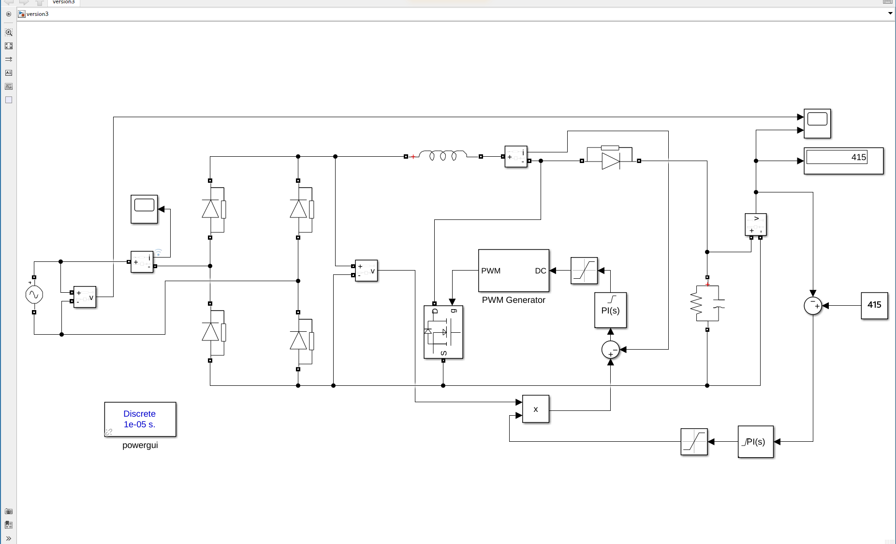
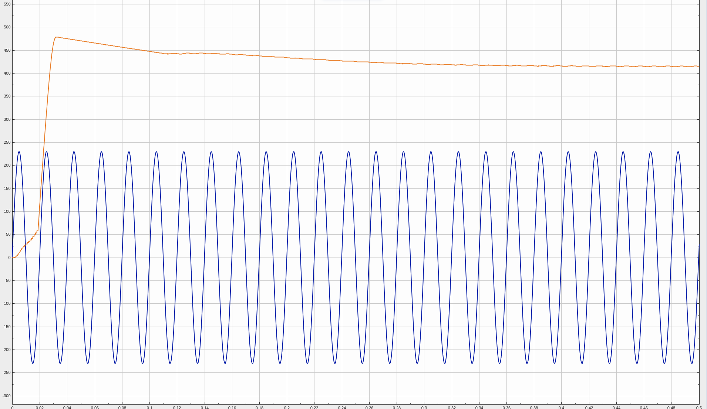
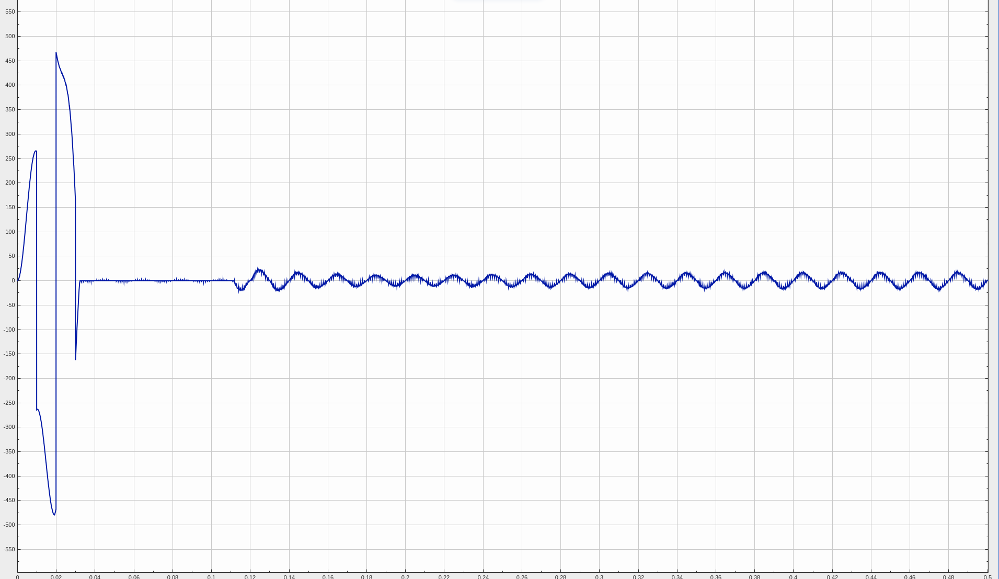
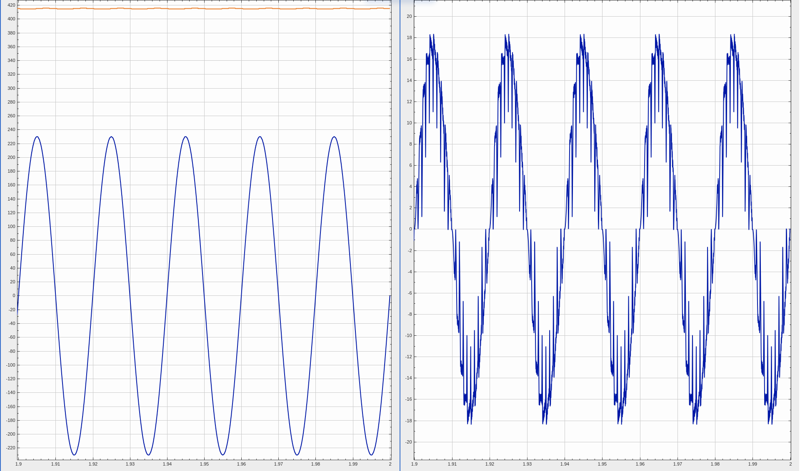
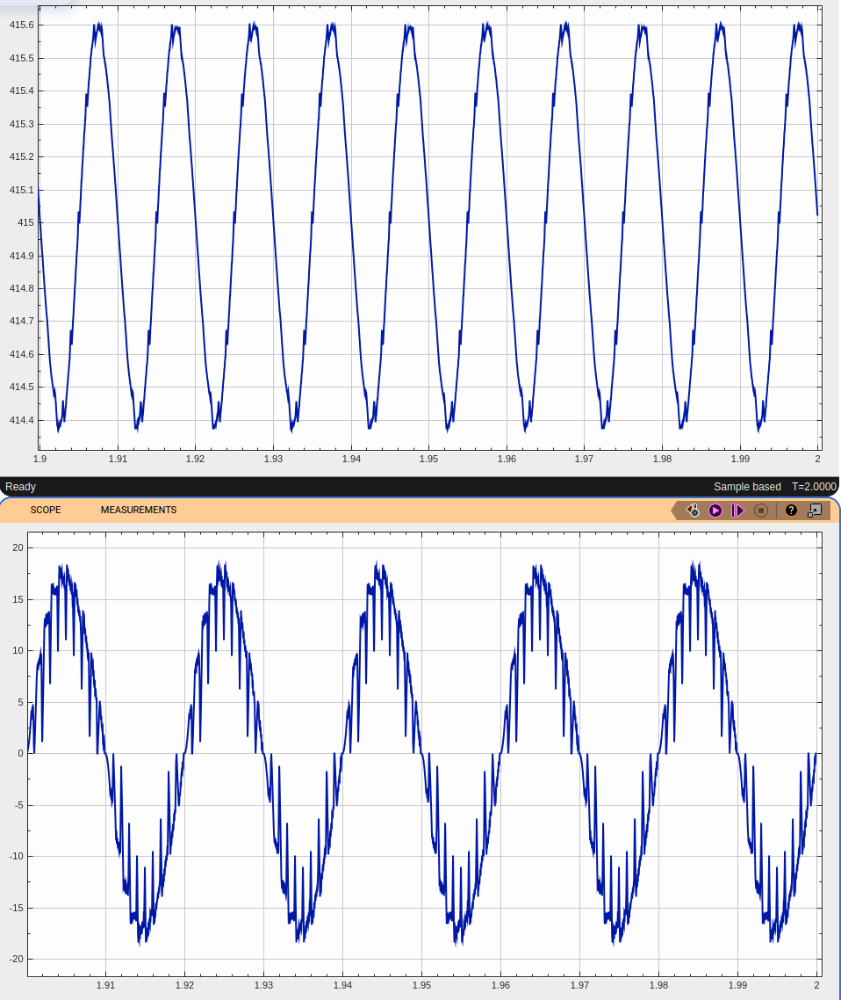
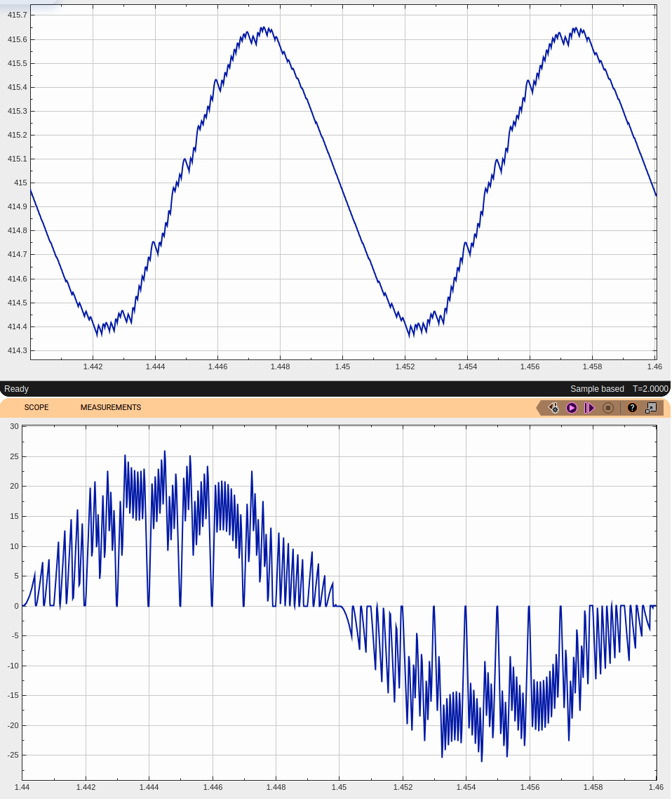

# 5. Inner Current Loop
Three ways of adding an inner inductor-current loop to the voltage loop from stage 4. Version 3 is the final design: cascaded loops with a voltage-shaped current reference, which gives power factor correction. A full write-up is in `report.pdf`.

## 5.1 Version 1: Peak current mode
Voltage PI sets a current limit, which is compared against the sensed inductor current. An SR latch with a clock sets the switching. Output reads about 413.5 V (415 V reference).

| File | Description |
|------|-------------|
| `version1.slx` | Simulink model |
| `5.1a.png` | Circuit |
| `5.1b.png` | Output waveforms |

## 5.2 Version 2: Cascaded PI
Voltage PI output is the current reference for a second PI, which drives the PWM generator. Output reads about 414.9 V (415 V reference).

| File | Description |
|------|-------------|
| `version2.slx` | Simulink model |
| `5.2a.png` | Circuit |
| `5.2b.png` | Output waveforms |

## 5.3 Version 3: Cascaded PI with voltage-shaped current reference (PFC)
The rectified bus voltage is multiplied by the voltage PI output, so the current reference is a rectified sine whose amplitude is set by the voltage loop. The inner PI tracks it and drives the PWM generator. The input current becomes a sine in phase with the source voltage. The inductor was enlarged and the PWM carrier frequency raised to get out of discontinuous conduction (`5.3f.png` shows the problem).

| Parameter | Value |
|-----------|-------|
| Source | 230 V peak, 50 Hz |
| Inductor L | 3 mH |
| Output capacitor C | 10 mF |
| Load R | 100 ohm |
| Reference | 415 V |
| Outer PI | P = 0.005, I = 0.05 |
| Inner PI | P = 0.5, I = 100 |
| Solver | Discrete, 1e-5 s |
| Stop time | 0.5 s (cold start), 2 s (steady state) |

| Result | Value |
|--------|-------|
| Steady-state output | 415 V |
| Output ripple | about 1.2 V peak to peak (0.3 %) at 100 Hz |
| Input current | sinusoidal, about 15 A envelope, spikes to about 18 A, in phase with source voltage |
| Cold start (capacitor at 0 V) | overshoot to about 480 V at 0.03 s, inrush about 480 A, back to 415 V by about 0.5 s |
| THD | not measured |

Known weak spots: no anti-windup, no soft-start ramp, and the outer PI upper limit (600) is far too loose to limit the inrush. Details in the report.

| File | Description |
|------|-------------|
| `version3.slx` | Simulink model |
| `5.3a.png` | Circuit |
| `5.3b.png` | Cold start: source voltage and output voltage, 0 to 0.5 s |
| `5.3c.png` | Cold start: source current, 0 to 0.5 s |
| `5.3d.png` | Steady state: source voltage and source current |
| `5.3e.png` | Steady state: output voltage ripple and source current |
| `5.3f.png` | Source current in discontinuous conduction, before the fix |
| `report.tex`, `report.pdf` | Report |

