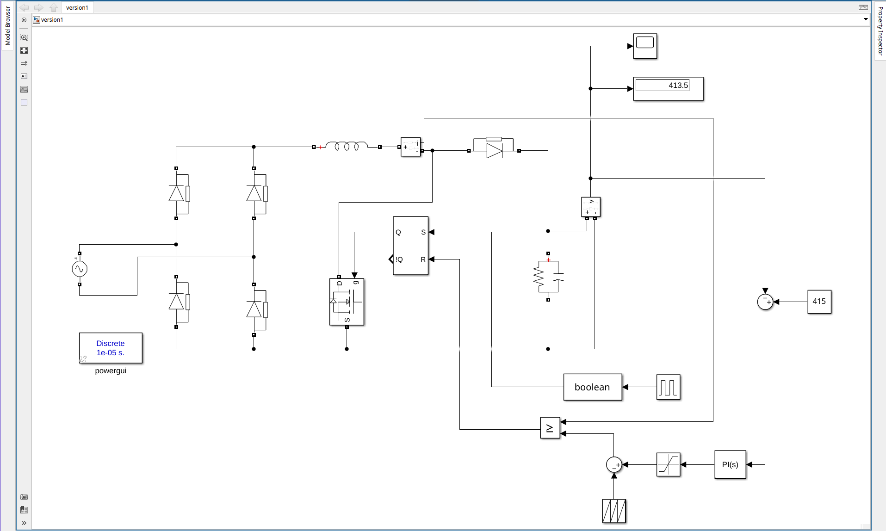
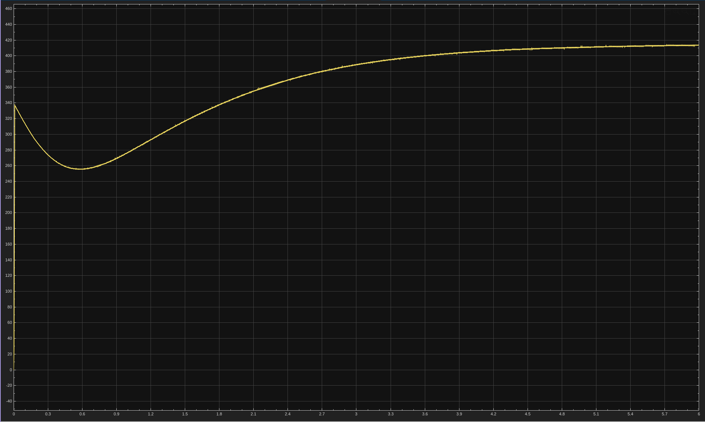
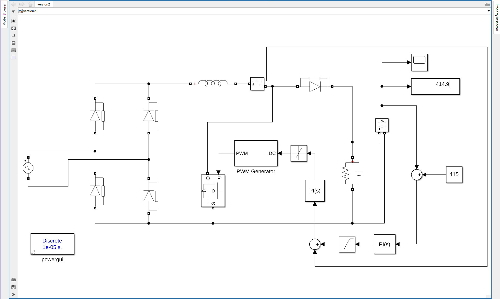
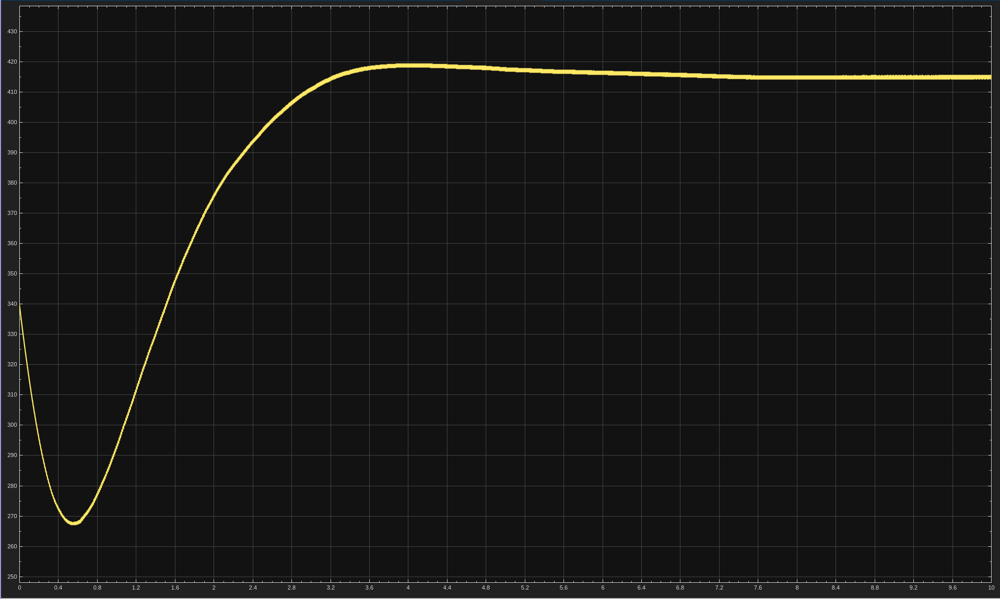

# 5. Inner Current Loop
Two ways of adding an inner inductor-current loop to the voltage loop from stage 4.

## 5.1 Version 1: Peak current mode
Voltage PI sets a current limit, which is compared against the sensed inductor current. An SR latch with a clock sets the switching. Output reads about 413.5 V (415 V reference).

| File | Description |
|------|-------------|
| `version1.slx` | Simulink model |
| `5.1a.png` | Circuit |
| `5.1b.png` | Output waveforms |

## 5.2 Version 2: Cascaded PI
Voltage PI output is the current reference for a second PI, which drives the PWM generator. Output reads about 414.9 V (415 V reference).

| File | Description |
|------|-------------|
| `version2.slx` | Simulink model |
| `5.2a.png` | Circuit |
| `5.2b.png` | Output waveforms |

