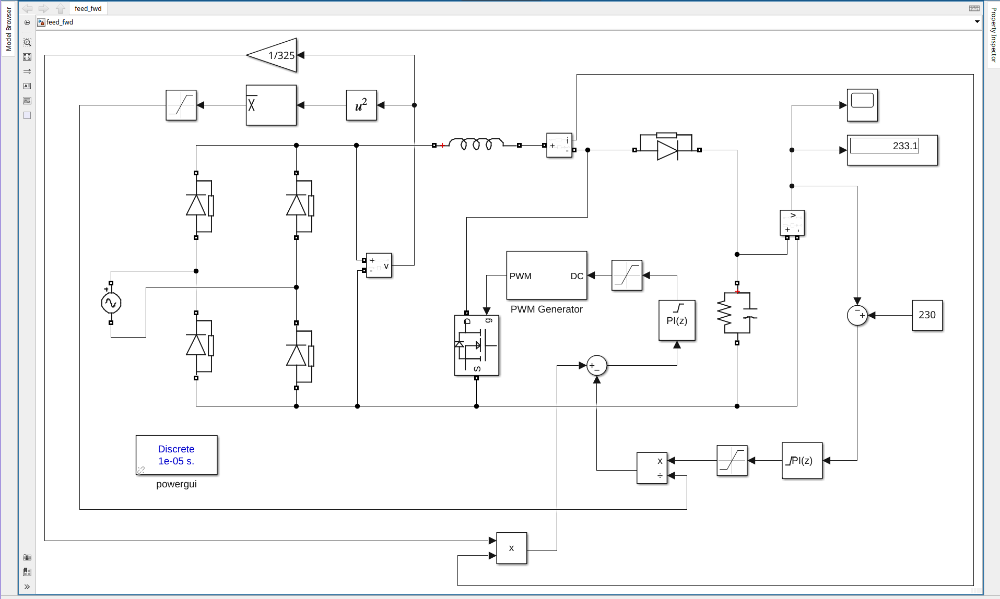
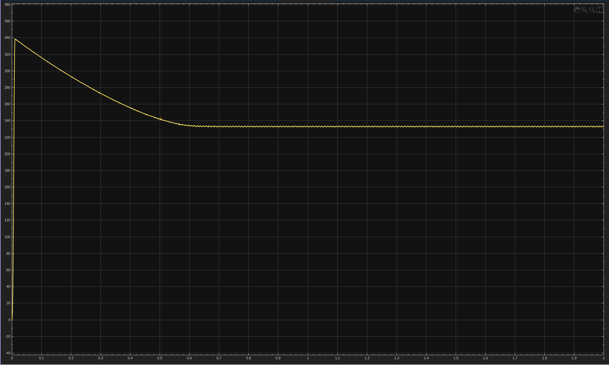

# 6. Feed-Forward Control
Adds input-voltage feed-forward to the cascaded loop: the rectified input is squared, averaged and scaled (1/325), then combined with the voltage-loop output through a multiplier and divider to form the current reference. 230 V reference, output reads about 233 V.

| File | Description |
|------|-------------|
| `feed_fwd.slx` | Simulink model |
| `6a.png` | Circuit |
| `6b.png` | Output waveforms |

